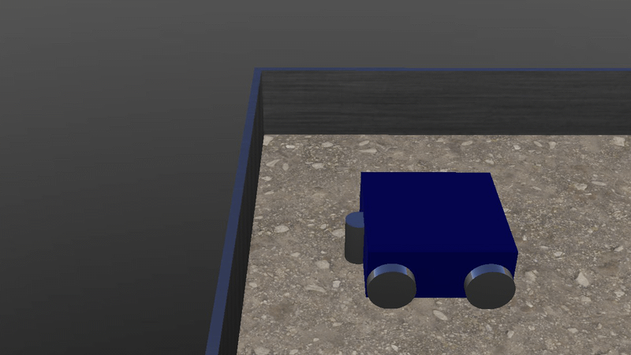
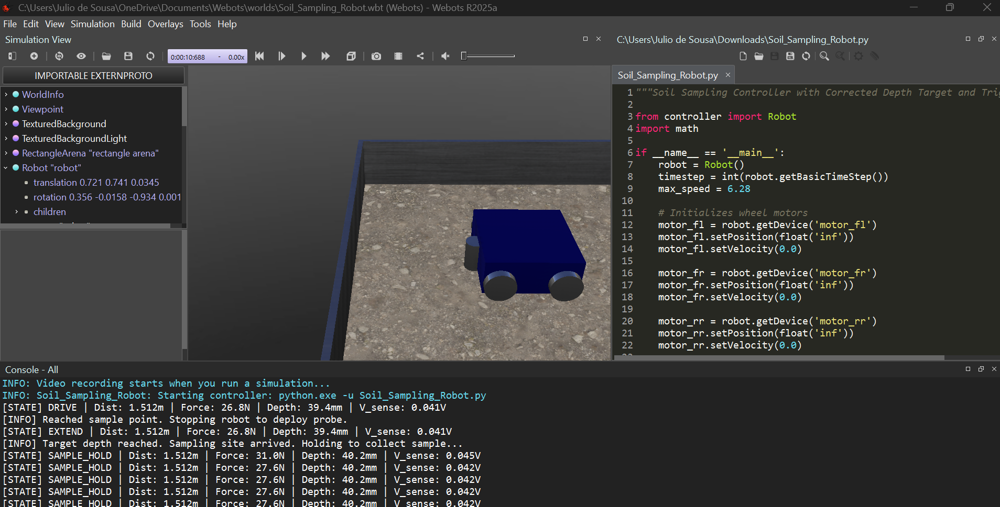

# Webots Soil Sampling Robot

Simulation of an agricultural soil-sampling UGV in Webots featuring linear actuator probe control and soil hardpan damage prevention.

# Simulation Demo & Visuals

# Actuator & Hardpan Prevention Demo

The UGV moves between sampling sites and lowers its probe upon arrival. Force data at the probe tip is mapped to actuator voltage/load, and if it exceeds a set threshold, the actuator retracts to prevent damage.

# Simulation View

Snapshot of the Webots simulation environment (`Soil_Sampling_Robot.wbt`) and soil-sampling setup controlled by `Soil_Sampling_Robot.py`.

#Key Features
* Sampling Site Navigation & Probe Deployment:** Drives between sampling locations and lowers the sampling probe upon arrival.
* Force-to-Voltage Overload Protection:** Simulates probe-tip force in Newtons, maps it to actuator voltage, and triggers retraction when a threshold is exceeded to prevent hardpan/actuator damage.
* Complete Webots Setup:** Includes the `Soil_Sampling_Robot.wbt` world file and `Soil_Sampling_Robot.py` controller script.

#How to Run
1. Install **Webots** and **Python** on your computer.
2. Clone or download this repository.
3. Open `Soil_Sampling_Robot.wbt` in Webots and run the simulation with `Soil_Sampling_Robot.py` attached.
